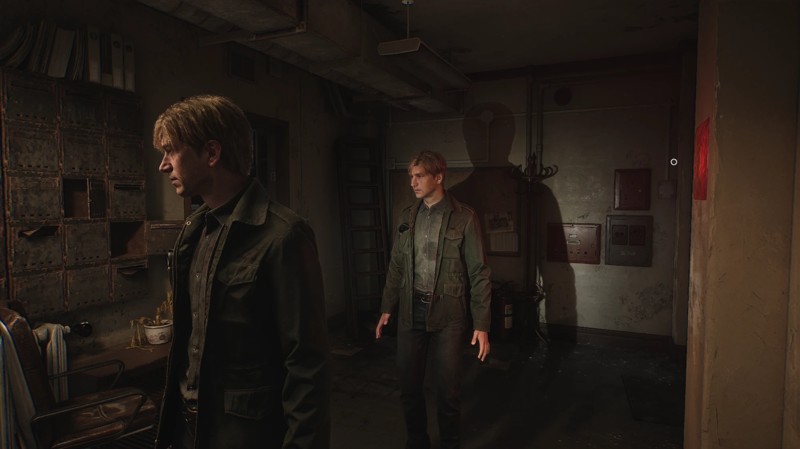
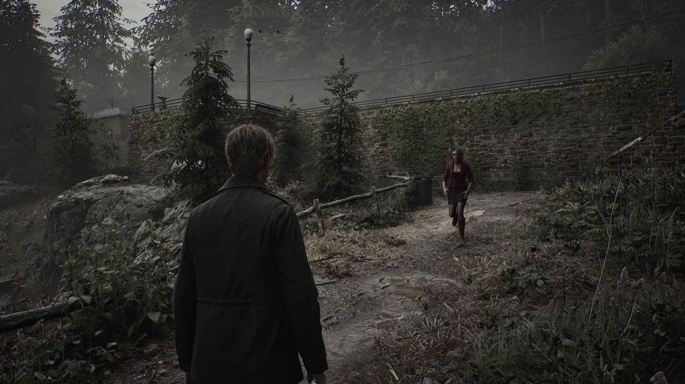
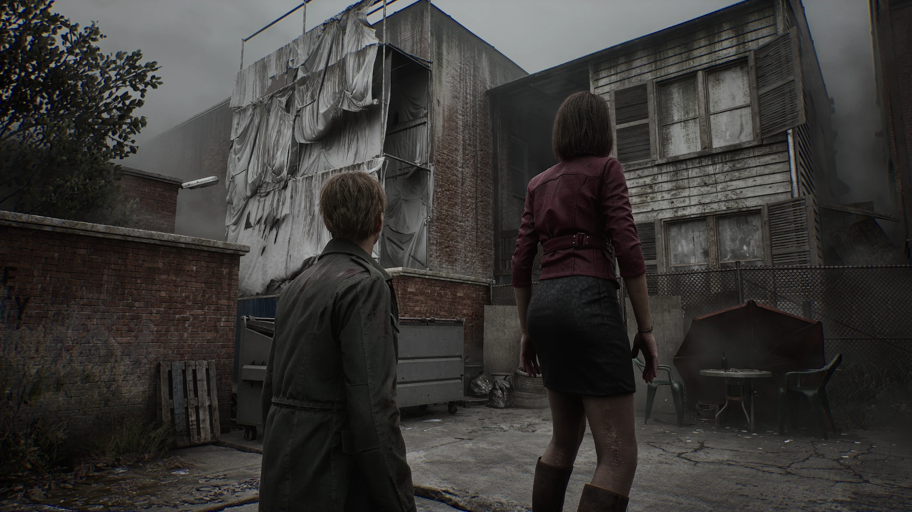
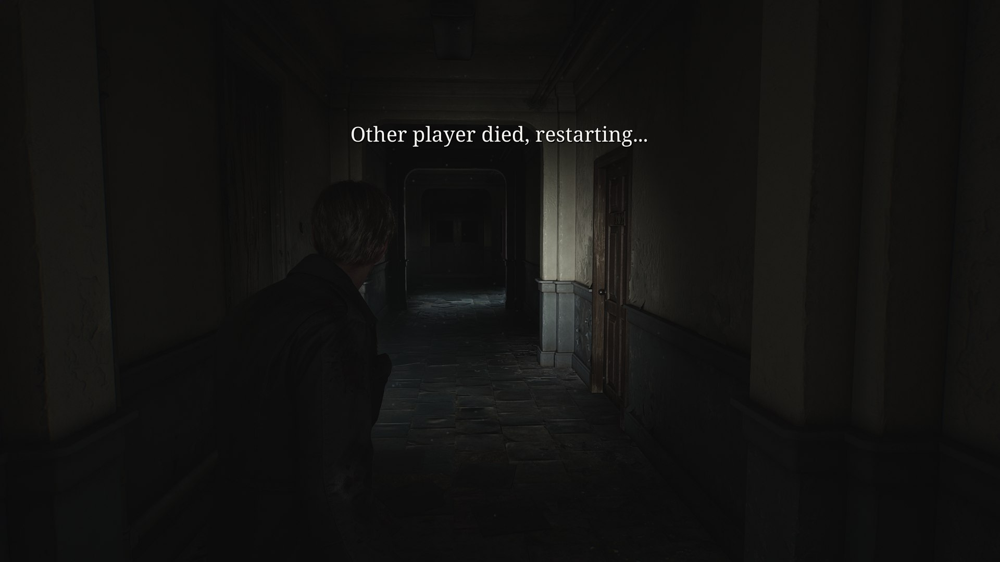
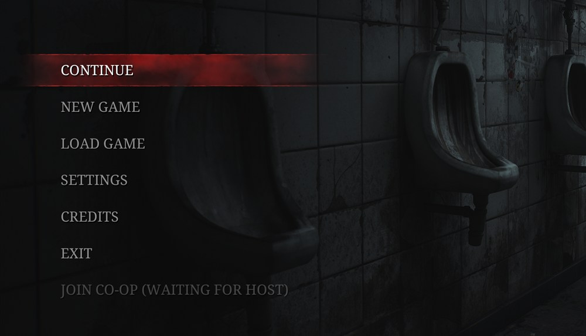
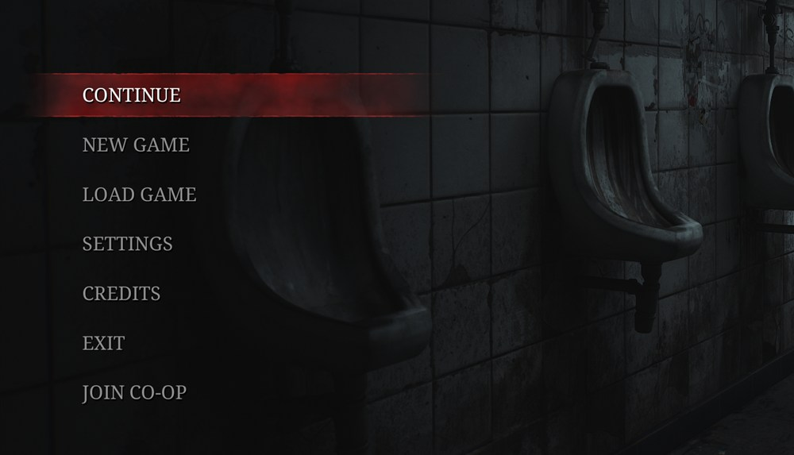
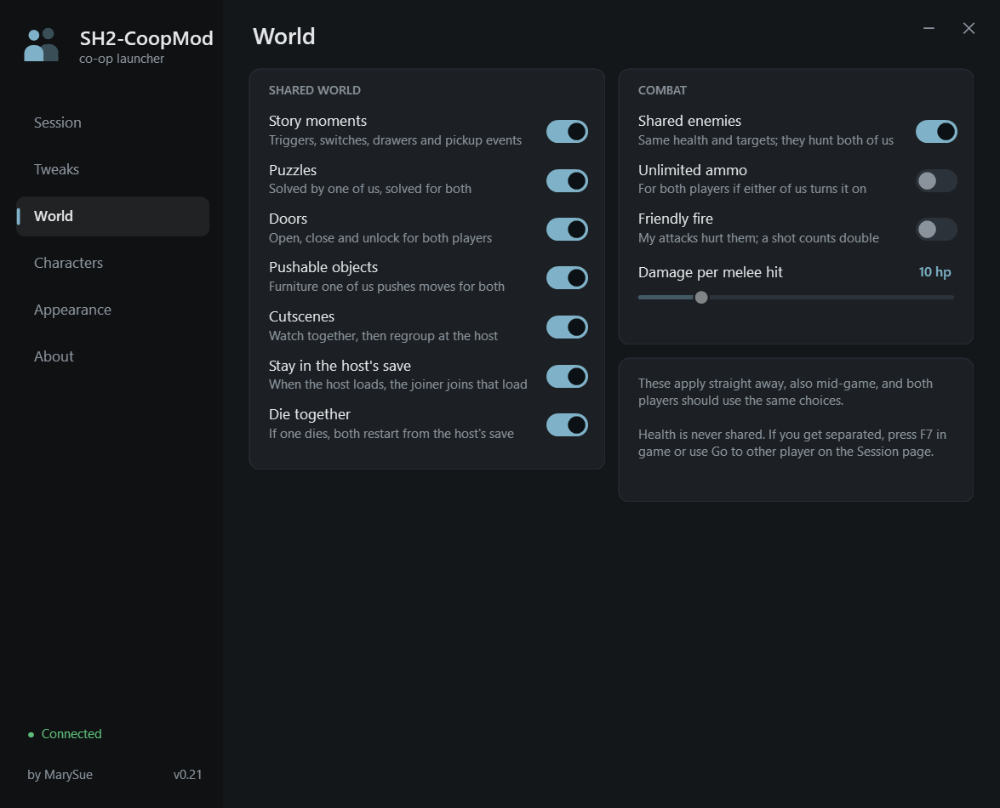

# SH2-CoopMod

**Co-op mod for Silent Hill 2 (2024): play the whole game together with a friend.** Authored by MarySue.

The game has no multiplayer. SH2-CoopMod adds it. Two players go through the campaign side by
side, each on their own PC, connected over Radmin VPN, Hamachi or a LAN. You see each other
fully animated, share one inventory and fight the same enemies, and when one of you solves a
puzzle or triggers a cutscene the story moves on for both.

**[Download the latest release](https://github.com/MarySueXLsD/Silent-Hill-2-Remake-Cooperative-Mod/releases/latest/download/SH2-CoopMod.zip)** · [How to play](#play) · [Инструкция на русском](docs/INSTALL_RU.md)

> Unofficial fan project. Not affiliated with or endorsed by the game's developer or publisher.
> You need your own copy of the game. This repository contains no game files.

## Preview

| | |
|---|---|
|  |  |
|  |  |


Joining is one entry in the game's own main menu, **Join co-op**:

| Host not in the game yet | Host in the game |
|---|---|
|  |  |

The entry is labelled in English, or in Russian («Совместная игра») when the game is set to
Russian.

The launcher:


## What is shared

| | |
|---|---|
| **The other player** | Visible in your world with full-body animation, their equipped weapon, flashlight and radio, and a real flashlight beam that lights your surroundings |
| **Inventory** | One inventory for both: ammunition, healing items, documents, weapons, keys and puzzle items. Each kind can be switched off |
| **Pickups** | An item taken by one player is taken for both, with the game's own "collected" popup and "new" mark for both |
| **Story moments** | Story triggers, one-shot events, switches, drawers and cupboard doors set off by one player go off in both games, and what the level hangs on a pickup ("when the coin is taken, ...") runs in both |
| **Puzzles** | Solved by one player, solved for both: safes, padlocks, door locks, cabinet puzzles, valves |
| **Doors** | Open, close and unlock for both, and react to the other player walking through |
| **Pushable objects** | Furniture one player pushes moves for both |
| **Cutscenes** | Both players watch together, then carry on side by side where the host is |
| **Enemies** | Same health for both, and a kill by one player is a death in both games, played as the enemy's own death. A hit that staggers or floors an enemy does the same in the other game, for the enemy kinds that take it. They hunt whichever player is closer |
| **Gunshots** | The other player's shots are heard from where they stand, with a muzzle flash |
| **Death** | One life for the pair: when either player dies, both restart from the host's last save. The one still standing is told why |
| **Joining** | The joiner picks **Join co-op** in the game's main menu and loads straight into the host's game, beside them. No need to have the same save |
| **Loading** | Whenever the host loads a save (or the pair restarts), the joiner is taken back through the main menu into that same load, by itself |
| **Characters** | Play as James, Maria, Angela or Mary, for the other player and on your own screen |

Kept separate on purpose: health, and the map and item-inspection screens.
Optional extras: unlimited ammunition, collision between the players, and friendly fire.

The intended way to play: you share one inventory, one of you works a puzzle with the items you
found, and when it is solved the story moves on for both.

## Known limits

- The mod is new. Played between two PCs so far: joining from the main menu with the host's save
  copied across, the shared inventory and pickups, doors, puzzles, watching cutscenes together,
  F7, and reconnecting after a drop.
- What came with 0.20 and 0.21 (story moments, dying together, following the host's loads,
  enemy deaths and hit reactions, gunshots, pickup popups, unlimited ammo) has been checked on
  one PC, by feeding the mod the other player's messages, and in one real session in which the
  two players turned out to be on different versions of the mod. It has not yet been played
  with both players on the same version. Please report what breaks.
- Not shared yet: half-finished puzzle progress (one player does the puzzle), bosses, sliding
  doors opening and closing, item containers and elevators. Press **F7** to jump to the other
  player if something separates you.
- Puzzles and readable things that zoom the camera in are worked by one player on their own
  screen; the other does not see the close-up. The solved puzzle counts for both.
- Each game still runs its own copy of every enemy. Health, deaths and who they hunt are kept
  the same, and the joiner's copies are nudged to where the host's are, but the two copies are
  not animated in lockstep. A hit by the other player makes an enemy flinch or fall only for the
  enemy kinds that accept it (mannequins do; lying figures only take the death).
- The host's game is the reference. After a death or a load both players carry on from the
  host's save, and the joiner's state is replaced by the host's.
- The mod keeps a crash guard: before it asks the game for something on the other player's
  behalf it leaves a note, and if the game goes down right after the same thing twice, that one
  thing is skipped for three days (see `ipc\skip.txt` in the mod folder; delete it to reset).
- Both players need the same game build and the same version of the mod. Two different
  versions connect and look fine while much of the mod does nothing, so this is checked: the
  launcher updates the mod in the game folder before a session starts, and the launcher and the
  game both say so when the two games run different versions.
- Joining from the main menu copies the host's current save to the joiner. It goes into a spare
  save slot (number 9) that the game's own menus do not use; the joiner's own saves are left
  alone.

## The launcher

`CoopLauncher.exe` installs the mod, connects the two PCs and holds every setting. It has six
pages:

| Page | What is on it |
|---|---|
| **Session** | The game folder and the mod install, Host or Join, the other player's address, Start and Stop, the connection status and a log |
| **Tweaks** | The shared inventory, how the other player is drawn, their flashlight, network timing |
| **World** | What the two games keep in step, and combat |
| **Characters** | Who each player appears as |
| **Appearance** | The theme, and keeping the window on top |
| **About** | The version, and buttons for this page and the mod folder |

| Tweaks | World |
|---|---|
|  |  |

| Characters | Appearance | About |
|---|---|---|
|  |  |  |

Four themes are built in. Fog is the default, shown above. The other three:

| Rust | Moss | Paper |
|---|---|---|
|  |  |  |

### Settings

Every setting is saved as you change it and reaches a running game within about a second. Both
players should use the same choices on the World page.

| Page and card | Setting | Default |
|---|---|---|
| **Session** | Port (the same on both PCs) | 47777 |
| | Start the game too, when the session starts | on |
| **Tweaks**, Inventory | Shared inventory | on |
| | Host's inventory wins on connect (it replaces the joiner's) | on |
| | What is shared: ammunition / healing items / maps, notes and photos / weapons, keys and puzzle items | all on |
| **Tweaks**, Other player | Show the other player | on |
| | Held items (weapon, flashlight and radio on their body) | on |
| | Collision (their body blocks you, and enemies too) | off |
| | Size | 100 % |
| **Tweaks**, Flashlight | Their flashlight lights my world | on |
| | Beam casts shadows (looks better, costs performance) | off |
| | Beam brightness | 100 % |
| **Tweaks**, Network | Updates sent per second (30 / 15 / 10) | 30 |
| | Smoothing delay | 100 ms |
| | Hide other player after silence | 3 s |
| **World**, Shared world | Story moments (triggers, switches, drawers and pickup events) | on |
| | Puzzles | on |
| | Doors | on |
| | Pushable objects | on |
| | Cutscenes | on |
| | Stay in the host's save (when the host loads, the joiner joins that load) | on |
| | Die together (if one dies, both restart from the host's save) | on |
| **World**, Combat | Shared enemies | on |
| | Unlimited ammo (for both players if either turns it on; you still reload) | off |
| | Friendly fire (both players must enable it) | off |
| | Damage per melee hit (a shot is double) | 10 hp |
| **Characters** | My character, as the other player sees me | James |
| | See myself as this character too | on |
| | Other player on my screen (overrides their choice) | their choice |
| **Appearance** | Theme (Fog, Rust, Moss, Paper) | Fog |
| | Keep the launcher on top | off |

## Requirements

- Windows, and the PC version of the game. Built and tested on game build 1.0.0.5.
- Both players on the same game build and the same version of the mod.
- A network where the two PCs can reach each other by IP: Radmin VPN, Hamachi or LAN.
- [UE4SS](https://github.com/UE4SS-RE/RE-UE4SS) (experimental build), which loads the mod.
  The packaged release bundles it; from source you install it yourself.

## Play

1. Download [`SH2-CoopMod.zip` from the latest release](https://github.com/MarySueXLsD/Silent-Hill-2-Remake-Cooperative-Mod/releases/latest/download/SH2-CoopMod.zip),
   unzip it anywhere and run `CoopLauncher.exe`. (Or build it yourself with
   `tools\build_dist.ps1`, see below.) A step-by-step guide in Russian is in
   [docs/INSTALL_RU.md](docs/INSTALL_RU.md) and inside the zip as `README_RU.txt`.
2. Set the game folder (the one containing `SHProto.exe`) and press **Install / update mod** if
   the launcher says the mod is not installed. If the game is under Program Files the launcher
   offers to restart itself as administrator.
3. One player picks **Host**, the other **Join**. Each enters the *other* player's address. The
   launcher lists your own addresses; click one to copy it.
4. Press **Start session**. Allow the launcher through the firewall if asked (UDP and TCP
   47777).
5. The host loads a save or starts a new game, as usual.
6. The joiner stays in the game's main menu. It has a new entry at the bottom, **Join co-op**,
   greyed out while the host is not in the game yet. Once it lights up, pick it: the host's game
   saves, the save is copied across and loaded, and the joiner appears beside the host. The
   status in the launcher turns green when packets arrive from the other player.

The joiner never has to load a save themselves, and does not need a copy of the host's save.

While you play:

- **F7** moves you to the other player, for when an elevator, a drop or anything unsynced
  separates you. The **Go to other player** button on the Session page does the same.
- When either of you dies, both restart from the host's last save. The player still standing
  sees "Other player died, restarting...". The joiner's game then goes back to the main menu and
  joins the host again by itself; there is nothing to press.
- When the host loads a save, the joiner is taken into that load the same way. With **Stay in
  the host's save** on (the default), a joiner who loads a save of their own is brought back
  into the host's game too.
- **F9** toggles a solo test: the other player's body appears beside you and copies you.

If the two games do not connect:

- Both PCs have to let `CoopLauncher.exe` through the firewall: UDP 47777, and on the host also
  TCP 47777, which carries the save to the joiner. An antivirus that brings its own firewall can
  block the launcher even when Windows Firewall allows it.
- Several VPN clients running at once (say Hamachi or Tailscale next to Radmin VPN) can send the
  traffic out through the wrong adapter. Close the ones you are not using.
- Check that each player entered the *other* player's address, and that both use the same port.

To update, both players download the new zip, unzip it and start a session from the new
launcher with the game closed: it updates the mod in the game folder first. (A new launcher is
not yet a new mod. The game keeps running the old one until the launcher has replaced it, and
with different versions on the two PCs most of the mod quietly does nothing. The launcher's log
and a line on the game's screen tell you when that is the case.) What changed in each version
is listed on the
[releases page](https://github.com/MarySueXLsD/Silent-Hill-2-Remake-Cooperative-Mod/releases).

To uninstall, delete `dwmapi.dll` and the `ue4ss` folder from `<game>\SHProto\Binaries\Win64`.

## How it works

The game ships without any networking, and Lua inside UE4SS has no sockets, so the design is:

```
 game A  <-- files -->  launcher A  <== UDP over VPN ==>  launcher B  <-- files -->  game B
 (mod)       ipc\                                                          ipc\       (mod)
```

(Plus one TCP connection whenever the joiner enters the host's game, to carry the host's save.)

Each game keeps running the whole game for its own player. The mod's job is to make the two
agree, and where they cannot both be right, the host's game is the reference.

- **The mod** (`SH2-CoopMod\Scripts\core.lua`) runs inside each game. About 30 times a second it
  measures the local player (position, 27 bone rotations, held items, flashlight) and writes
  that to `ipc\out.txt`. It reads the other player's state from `ipc\in.txt`.
- **The launcher** carries those small text packets between the PCs over UDP.
- **Two kinds of message** travel that way. State (where the player is, what the doors and
  enemies near them are doing) is simply sent again and again. Events (an item gained, an enemy
  killed, a puzzle solved, a trigger set off, a death) are numbered and resent until the other
  side acknowledges them, so they also survive a dropped connection.
- **The other player's body** is a poseable copy of a character mesh already in your game. No
  animation blueprint runs on it; every rendered frame its bones are set to a blend of the two
  most recent snapshots, drawn slightly in the past so network jitter does not show.
- **Inventory** is synced as events: each gain or loss is one. On connect the host's inventory
  is the starting point. What arrives from the other player is shown with the game's own
  "item collected" popup and carries the "new" mark in the inventory.
- **Seeing yourself as another character** keeps the real James animating but invisible, and
  poses a second body from him every frame, fingers included.
- **Doors** are each driven by one game: the one whose player stands closer. That game reports
  the door's angle and the other moves its copy to match, holding off the door's auto-close
  while it does. Where no game is driving a door, the other player's body pushes it open
  locally, away from the side they stand on. Unlocks travel as events; re-locks do not, because
  the game also locks doors behind the player to gate areas.
- **Cutscenes** are identified by their level path. When one starts, the other player is moved
  to where it was triggered, which normally makes their own game trigger it too, with all the
  logic attached; if it has not started after a moment it is started directly. Afterwards the
  joiner is placed beside the host.
- **Pickups** taken in one game are marked collected and removed in the other, so a shared
  item is not collected twice. Levels hang story on pickups, so whatever is listening for that
  pickup being collected is told there as well. Freshly streamed-in doors and pickups are left
  alone for a few seconds, since the game is still applying their saved state.
- **Story moments**: the story is driven by trigger boxes placed in the levels (walk in and a
  cutscene starts, enemies appear, a door slams, a sound plays), by one-shot event boxes, and
  by simple "press to use" objects such as switches, drawers and cupboard doors. Each game only
  notices its own player. So when a player sets one off, the other game is told which object it
  was and calls the very handler that object runs for a real player, with its own player named
  as the one who did it; whatever the level wired to it follows. Triggers that are about where
  one player stands (what to stream in, where to crouch, the map, music, when enemies give up)
  stay each game's own business. A request for an object that is not loaded yet waits for it,
  for up to three minutes.
- **Puzzles** you zoom in on all carry the same component, with a solved state and a "set
  solved" call. When one becomes solved in one game, the other game marks its copy solved,
  which runs that puzzle's own follow-up there: the lock opens, the item appears, the cutscene
  starts. A puzzle you are in the middle of is not solved under you; it waits until you step
  away.
- **Pushable objects** are driven by whoever is pushing: their game reports the object's
  position and the other game moves its copy with the pushable's own "teleport to" call. The
  resting place is sent once more as an event when they let go.
- **Saving**: each PC keeps its own save files. When the host's game saves, the joiner's game
  saves at the same moment (into the same slot number when the host used one), so the joiner's
  own files keep up with the story.
- **Joining from the main menu**: while the joiner has no player yet, the mod adds an entry to
  the main menu, an engine-made copy of the game's own "Load game" entry with its click
  replaced. The host's game only sends packets while the host is in the game, so fresh packets
  switch the entry on. Picking it drops a request file; the joiner's launcher asks the host's
  launcher over TCP (same port number, and only the configured other player is answered); that
  launcher tells its game to write a save into slot 9 and sends the file back; the joiner's
  launcher stores it as its own slot 9, and the mod loads that slot with the menu's own
  "load saved game" call. After loading, the joiner is placed beside the host.
- **Loading**: the joiner never loads a file of its own to follow the host. The host counts its
  loads and puts the number in every packet. A number other than the one the joiner joined at
  means the host is in a different load, so the joiner's game goes back to the main menu and
  the mod picks **Join co-op** itself, which copies the host's state over as above. A joiner
  who loads one of their own saves while the host is playing is taken into the host's game the
  same way.
- **Noticing a load** is less obvious than it sounds. Most loads show as a stretch with no
  player: the menu, a loading screen. A reload of the level you are already in, which is what
  happens after a death, does not: the game is busy for the whole of it, and the next time the
  mod looks there is a player again, a new one in a new world. So the mod asks the world
  itself. A different world object, or the world's clock (which starts from zero in every
  freshly loaded world) running backwards, means a load went by, and everything remembered
  about the old level is dropped: the dead enemies, the taken pickups, the inventory count.
- **Versions**: every packet names the version of the mod that wrote it. A newer mod sends
  things an older one does not know and simply skips, so two different versions connect and
  look fine while half of the mod does nothing. When the versions differ, the mod puts a line
  on the screen and the launcher says so in its log and status.
- **Dying together**: each game watches its own player's health. A death is sent as an event,
  and the other game puts a line of text on the game's own HUD, in the HUD's font. A few
  seconds later the host's game reloads its last save. The joiner's game returns to the main
  menu, waits there until the host's load counter has moved on, and then joins, so both
  players are in exactly the same state again.
- **Enemies** run in both games; they come from the same spawners placed in the level, so a
  hash of the spawner's path names an enemy on both PCs. Animation, attacks and damage to the
  local player stay native. The mod makes the two copies agree. Both games list the enemies
  near their player about ten times a second: position, health and who each one is after.
  Damage either player deals is sent as an event and applied to the other copy, never as the
  killing blow, with the host's health as the reference. A death is sent on its own and it
  wins: an enemy dead in one game is killed in the other, also one that only loads in later.
  An enemy hunting one player is sent after that player's body in the other game, and goes for
  whoever is clearly closer; only enemies that are already alert are redirected, never dormant
  ones. The joiner's copy is nudged toward the host's position. An enemy that a scripted scene
  spawned in one game only is spawned in the other by asking the same spawner.
- **How an enemy falls**: health in this game is only a number. Staggering, falling and dying
  are "hit reactions", chosen and played by a separate part of the enemy when a blow lands, so
  a kill carried over as a number leaves the body standing. The mod therefore sends the
  reaction as well and plays it through the call the game itself makes. A death is the death
  reaction followed by the kill, and a body that still is not lying in its death a moment later
  is taken out of sight.
- **Gunshots**: the other player's body copies their pose, so it aims and recoils, but a pose
  carries no muzzle flash and no sound. Every shot is sent as an event that names the weapon's
  gunshot sound. The other game plays that sound from the body's gun hand and flashes a small
  light there.
- **Unlimited ammo**: about once a second the reserve of every kind of ammunition is filled
  back up to 60 rounds, so there is always something to reload with. A kind is covered from the
  first time the mod has seen it, in the inventory or named by a firearm in the level. Each
  game refills its own reserve, so the top-ups are not sent as pickups, and the switch itself
  travels in the packets, which is why one player turning it on is enough.
- **Friendly fire** is judged by the attacker's game (aim line for shots, reach and facing for
  melee) and applied by the victim's game through the game's own damage functions. Shots are
  not yet checked for walls in between.
- **Not taking the game down**: some of what the mod asks the game to do for the other player
  can crash it outright, where no error handling helps, and because unacknowledged events are
  resent, the same request would do so again on every launch. So before each such call the mod
  leaves a note saying what it is about to do, and removes it a couple of seconds later. A note
  still there at the next start means the game went down right after that call. The first time
  it is only remembered; the second time that call is skipped for three days. For the same
  reason nothing is read from disk in the first 20 seconds after a load: a blocking asset load
  while the game is still streaming the level crashed its loading thread, so the other player's
  character model and held item are filled in a moment later instead.

`core.lua` is hot-reloaded when it changes, so the mod can be developed with the game running.

## Building from source

Requirements: Windows with .NET Framework 4 (for the bundled C# compiler) and PowerShell.

```powershell
powershell -ExecutionPolicy Bypass -File tools\build_dist.ps1
```

This compiles the launcher and assembles `dist\SH2-CoopMod\` and `dist\SH2-CoopMod.zip`. It copies
UE4SS from your own game folder, so install UE4SS into the game first.

Regenerate the launcher screenshots on this page (demo data, no personal settings) with:

```powershell
dist\SH2-CoopMod\CoopLauncher.exe --screenshots docs\screenshots --scale 1.25
```

## Project layout

| Path | What |
|---|---|
| `SH2-CoopMod\Scripts\main.lua` | Tiny bootstrap; reloads `core.lua` whenever it changes |
| `SH2-CoopMod\Scripts\core.lua` | The mod |
| `SH2-CoopMod\relay.ps1` | Script version of the launcher's network relay, kept as a fallback |
| `launcher\CoopLauncher.cs` | The launcher (WinForms, custom-drawn, single file) |
| `tools\build_dist.ps1` | Builds the launcher and the distributable zip |
| `tools\run.ps1`, `tools\cmd\` | Run Lua snippets inside the live game; the probes used to map it |
| `tools\list_pak_paths.ps1` | Lists asset paths from the game's container index |
| `docs\INSTALL_RU.md` | Step-by-step guide in Russian; ships in the zip as `README_RU.txt` |
| `docs\preview\`, `docs\screenshots\` | The in-game pictures and the launcher screenshots on this page |

## Credits

- [UE4SS](https://github.com/UE4SS-RE/RE-UE4SS) by the UE4SS-RE team, which makes scripting the
  game possible.
- Mod and launcher by MarySue.

## License

[MIT](LICENSE) for the code in this repository. The game, its characters and its assets belong
to their respective owners and are not included here.
