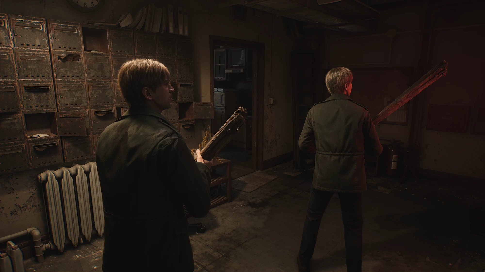
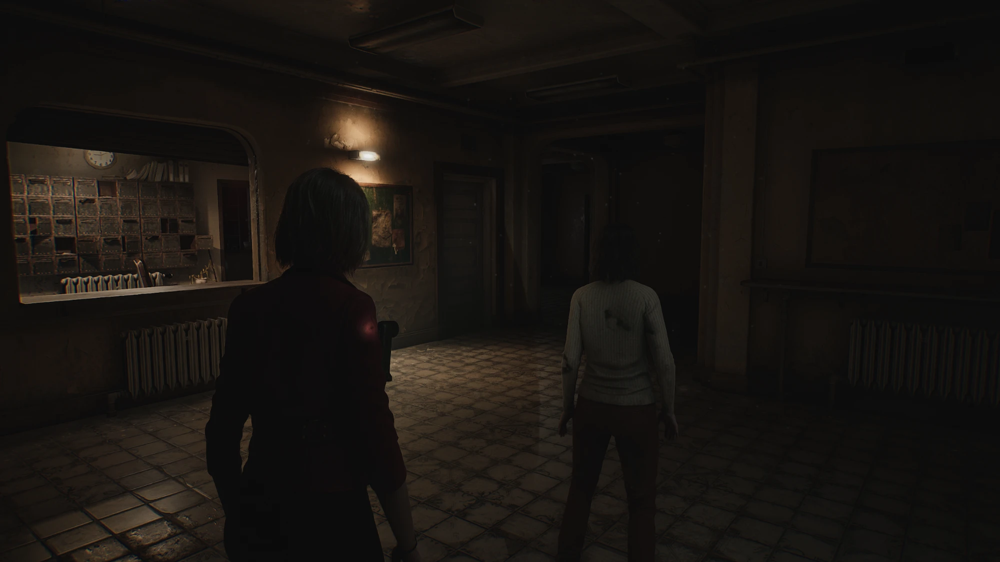

# SH2-CoopMod

**Co-op mod for Silent Hill 2 (2024): play the whole game together with a friend.** Authored by MarySue.

The game has no multiplayer. SH2-CoopMod adds it. Two players go through the campaign side by
side, each on their own PC, connected over Radmin VPN, Hamachi or a LAN. You see each other
fully animated, share one inventory and fight the same enemies, and when one of you solves a
puzzle or triggers a cutscene the story moves on for both.

> Unofficial fan project. Not affiliated with or endorsed by the game's developer or publisher.
> You need your own copy of the game. This repository contains no game files.

## Preview

| | |
|---|---|
|  |  |
|  |  |

Joining is one entry in the game's own main menu, **Join co-op**:

| Host not in the game yet | Host in the game |
|---|---|
|  |  |

The entry is labelled in English, or in Russian («Совместная игра») when the game is set to
Russian.

The launcher:


## What is shared

| | |
|---|---|
| **The other player** | Visible in your world with full-body animation, their equipped weapon, flashlight and radio, and a real flashlight beam that lights your surroundings |
| **Inventory** | One inventory for both: ammunition, healing items, documents, weapons, keys and puzzle items. Each kind can be switched off |
| **Pickups** | An item taken by one player is taken for both |
| **Puzzles** | Solved by one player, solved for both: safes, padlocks, door locks, cabinet puzzles, valves |
| **Doors** | Open, close and unlock for both, and react to the other player walking through |
| **Pushable objects** | Furniture one player pushes moves for both |
| **Cutscenes** | Both players watch together, then carry on side by side where the host is |
| **Enemies** | Same health and deaths for both, and they hunt whichever player is closer |
| **Joining** | The joiner picks **Join co-op** in the game's main menu and loads straight into the host's game, beside them. No need to have the same save |
| **Saving and loading** | The joiner saves when the host saves, and loads when the host loads |
| **Characters** | Play as James, Maria, Angela or Mary, for the other player and on your own screen |

Kept separate on purpose: health, and the map and item-inspection screens.
Optional extras: collision between the players, and friendly fire.

The intended way to play: you share one inventory, one of you works a puzzle with the items you
found, and when it is solved the story moves on for both.

## Known limits

- The mod is new. Most of it has been checked by one player against a simulated partner, and
  full two-player sessions have had little testing so far. Please report what breaks.
- Not shared yet: half-finished puzzle progress (one player does the puzzle), enemies from
  scripted groups and bosses, sliding doors opening and closing, plain switches, item
  containers and elevators. Press **F7** to jump to the other player if something separates you.
- If the host deliberately loads an older save slot, the joiner gets their own latest save.
- Both players need the same game build and the same version of the mod.
- Joining from the main menu copies the host's current save to the joiner. It goes into a spare
  save slot (number 9) that the game's own menus do not use; the joiner's own saves are left
  alone. It has been tested on one PC against a stand-in host, not yet between two PCs.

## The launcher

| Tweaks | World |
|---|---|
|  |  |

| Characters | |
|---|---|
|  | |

| Appearance | About |
|---|---|
|  |  |

Four themes are built in:

| Rust | Moss | Paper |
|---|---|---|
|  |  |  |

### Tweaks

All tweaks apply immediately, also while the game is running.

| Group | Tweak | Default |
|---|---|---|
| Inventory | Shared inventory | on |
| | Host's inventory replaces the joiner's on connect | on |
| | Share ammunition / healing items / maps, notes and photos / weapons, keys and puzzle items | all on |
| Other player | Show the other player | on |
| | Show held items (weapon, flashlight, radio) | on |
| | Collision (their body blocks you and enemies) | off |
| | Size | 100 % |
| World | Puzzles | on |
| | Doors | on |
| | Pushable objects | on |
| | Cutscenes | on |
| | Save and load together | on |
| Combat | Shared enemies | on |
| | Friendly fire (both players must enable it) | off |
| | Damage per melee hit (a shot is double) | 10 hp |
| Flashlight | Their flashlight lights my world | on |
| | Beam casts shadows | off |
| | Beam brightness | 100 % |
| Network | Updates sent per second (30 / 15 / 10) | 30 |
| | Smoothing delay | 100 ms |
| | Hide the other player after silence | 3 s |
| Characters | My character (what the other player sees) | James |
| | See myself as that character too | on |
| | Other player on my screen (overrides their choice) | their choice |
| Launcher | Theme, keep on top, start the game with the session | |

## Requirements

- Windows, and the PC version of the game. Built and tested on game build 1.0.0.5.
- Both players on the same game build and the same version of the mod.
- A network where the two PCs can reach each other by IP: Radmin VPN, Hamachi or LAN.
- [UE4SS](https://github.com/UE4SS-RE/RE-UE4SS) (experimental build), which loads the mod.
  The packaged release bundles it; from source you install it yourself.

## Play

1. Download [`SH2-CoopMod.zip` from the latest release](https://github.com/MarySueXLsD/Silent-Hill-2-Remake-Cooperative-Mod/releases/latest/download/SH2-CoopMod.zip),
   unzip it anywhere and run `CoopLauncher.exe`. (Or build it yourself with
   `tools\build_dist.ps1`, see below.) A step-by-step guide in Russian is in
   [docs/INSTALL_RU.md](docs/INSTALL_RU.md) and inside the zip as `README_RU.txt`.
2. Set the game folder (the one containing `SHProto.exe`) and press **Install / update mod** if
   the launcher says the mod is not installed. If the game is under Program Files the launcher
   offers to restart itself as administrator.
3. One player picks **Host**, the other **Join**. Each enters the *other* player's address. The
   launcher lists your own addresses; click one to copy it.
4. Press **Start session**. Allow the launcher through Windows Firewall if asked (UDP and TCP
   47777).
5. The host loads a save or starts a new game, as usual.
6. The joiner stays in the game's main menu. It has a new entry at the bottom, **Join co-op**,
   greyed out while the host is not in the game yet. Once it lights up, pick it: the host's game
   saves, the save is copied across and loaded, and the joiner appears beside the host. The
   status in the launcher turns green when packets arrive from the other player.

Two players who already have the same save can also just load it on both PCs, as before.

In game, **F9** toggles a solo test: the other player's body appears beside you and copies you.
**F7** moves you to the other player, for when an elevator, a drop or anything unsynced
separates you.

To uninstall, delete `dwmapi.dll` and the `ue4ss` folder from `<game>\SHProto\Binaries\Win64`.

## How it works

The game ships without any networking, and Lua inside UE4SS has no sockets, so the design is:

```
 game A  <-- files -->  launcher A  <== UDP over VPN ==>  launcher B  <-- files -->  game B
 (mod)       ipc\                                                          ipc\       (mod)
```

(Plus one TCP connection when a player joins from the main menu, to carry the host's save.)

- **The mod** (`SH2-CoopMod\Scripts\core.lua`) runs inside each game. About 30 times a second it
  measures the local player (position, 27 bone rotations, held items, flashlight) and writes
  that to `ipc\out.txt`. It reads the other player's state from `ipc\in.txt`.
- **The launcher** carries those small text packets between the PCs over UDP.
- **The other player's body** is a poseable copy of a character mesh already in your game. No
  animation blueprint runs on it; every rendered frame its bones are set to a blend of the two
  most recent snapshots, drawn slightly in the past so network jitter does not show.
- **Inventory** is synced as reliable events: each gain or loss is resent until the other side
  acknowledges it. On connect the host's inventory is the starting point.
- **Seeing yourself as another character** keeps the real James animating but invisible, and
  poses a second body from him every frame, fingers included.
- **Doors** are each driven by one game: the one whose player stands closer. That game reports
  the door's angle and the other moves its copy to match, holding off the door's auto-close
  while it does. Where no game is driving a door, the other player's body pushes it open
  locally, away from the side they stand on. Unlocks travel as reliable events; re-locks do
  not, because the game also locks doors behind the player to gate areas.
- **Cutscenes** are identified by their level path. When one starts, the other player is moved
  to where it was triggered, which normally makes their own game trigger it too, with all the
  logic attached; if it has not started after a moment it is started directly. Afterwards the
  joiner is placed beside the host.
- **Pickups** taken in one game are marked collected and removed in the other, so a shared
  item is not collected twice. Freshly streamed-in doors and pickups are left alone for a few
  seconds, since the game is still applying their saved state.
- **Puzzles** you zoom in on all carry the same component, with a solved state and a "set
  solved" call. When one becomes solved in one game, the other game marks its copy solved,
  which runs that puzzle's own follow-up there: the lock opens, the item appears, the cutscene
  starts. A puzzle you are in the middle of is not solved under you; it waits until you step
  away.
- **Pushable objects** are driven by whoever is pushing: their game reports the object's
  position and the other game moves its copy with the pushable's own "teleport to" call. The
  resting place is sent once more as a reliable event when they let go.
- **Saving and loading**: each PC keeps its own save files, and from code the game can only
  reload its latest save. So when the host's game saves, the joiner's game saves too (same slot
  number when the host used one), and when the host loads or dies, the joiner reloads its own
  latest save and is placed beside the host. If the host deliberately loads an older slot, the
  joiner still gets its latest.
- **Joining from the main menu**: while the joiner has no player yet, the mod adds an entry to
  the main menu, an engine-made copy of the game's own "Load game" entry with its click
  replaced. The host's game only sends packets while the host is in the game, so fresh packets
  switch the entry on. Picking it drops a request file; the joiner's launcher asks the host's
  launcher over TCP (same port number, and only the configured other player is answered); that
  launcher tells its game to write a save into slot 9 and sends the file back; the joiner's
  launcher stores it as its own slot 9, and the mod loads that slot with the menu's own
  "load saved game" call. After loading, the joiner is placed beside the host.
- **Enemies** run in both games; they come from the same spawners placed in the level, so a
  hash of the spawner's path names an enemy on both PCs. Animation, attacks and damage to the
  local player stay native. The mod makes the two copies agree: damage either player deals is
  sent as a reliable event and applied to the other copy, with the host's health as the
  reference; an enemy hunting one player is sent after that player's body in the other game,
  and goes for whoever is clearly closer; the joiner's copy is nudged toward the host's
  position. Only enemies that are already alert are redirected, never dormant ones.
- **Friendly fire** is judged by the attacker's game (aim line for shots, reach and facing for
  melee) and applied by the victim's game through the game's own damage functions. Shots are
  not yet checked for walls in between.

`core.lua` is hot-reloaded when it changes, so the mod can be developed with the game running.

## Building from source

Requirements: Windows with .NET Framework 4 (for the bundled C# compiler) and PowerShell.

```powershell
powershell -ExecutionPolicy Bypass -File tools\build_dist.ps1
```

This compiles the launcher and assembles `dist\SH2-CoopMod\` and `dist\SH2-CoopMod.zip`. It copies
UE4SS from your own game folder, so install UE4SS into the game first.

Regenerate the README screenshots (demo data, no personal settings) with:

```powershell
dist\SH2-CoopMod\CoopLauncher.exe --screenshots docs\screenshots --scale 1.25
```

## Project layout

| Path | What |
|---|---|
| `SH2-CoopMod\Scripts\main.lua` | Tiny bootstrap; reloads `core.lua` whenever it changes |
| `SH2-CoopMod\Scripts\core.lua` | The mod |
| `SH2-CoopMod\relay.ps1` | Script version of the launcher's network relay, kept as a fallback |
| `launcher\CoopLauncher.cs` | The launcher (WinForms, custom-drawn, single file) |
| `tools\build_dist.ps1` | Builds the launcher and the distributable zip |
| `tools\run.ps1`, `tools\cmd\` | Run Lua snippets inside the live game; the probes used to map it |
| `tools\list_pak_paths.ps1` | Lists asset paths from the game's container index |

## Credits

- [UE4SS](https://github.com/UE4SS-RE/RE-UE4SS) by the UE4SS-RE team, which makes scripting the
  game possible.
- Mod and launcher by MarySue.

## License

[MIT](LICENSE) for the code in this repository. The game, its characters and its assets belong
to their respective owners and are not included here.
