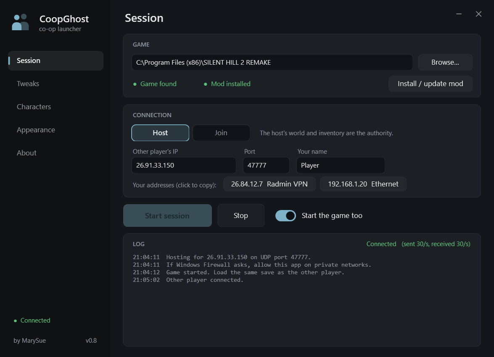
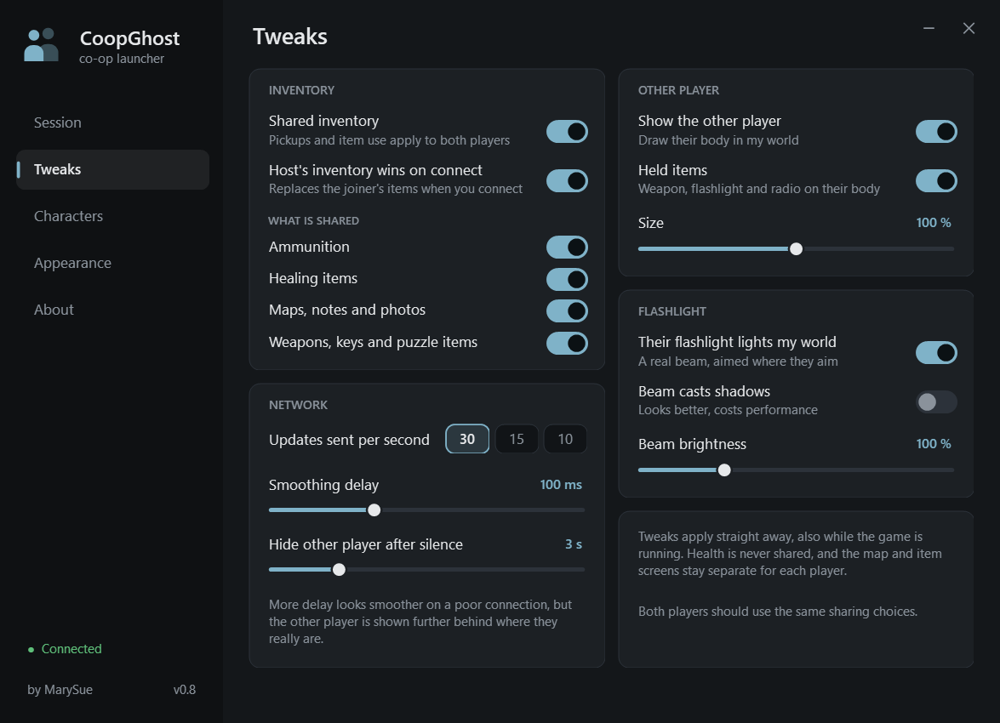
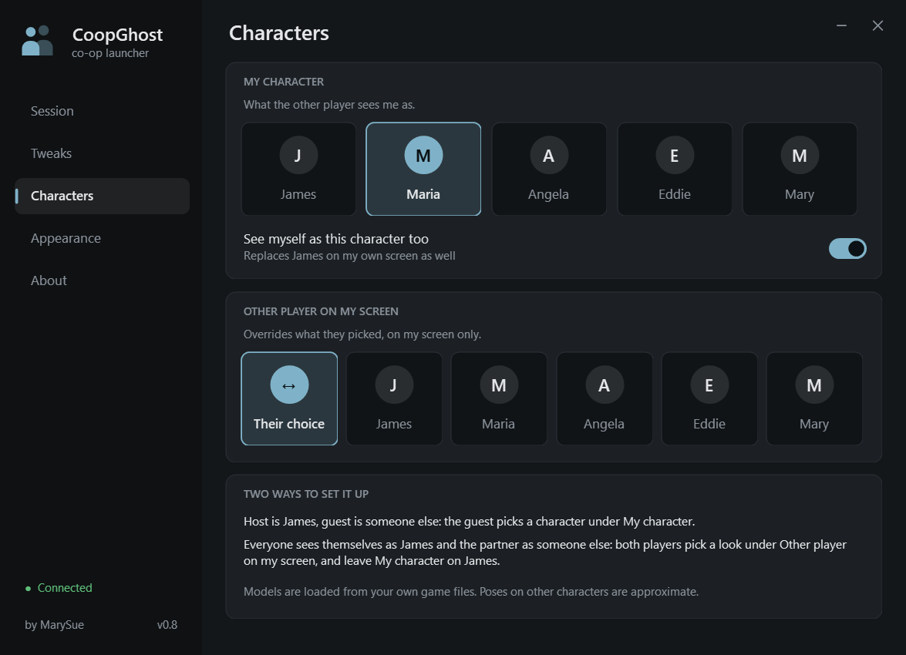
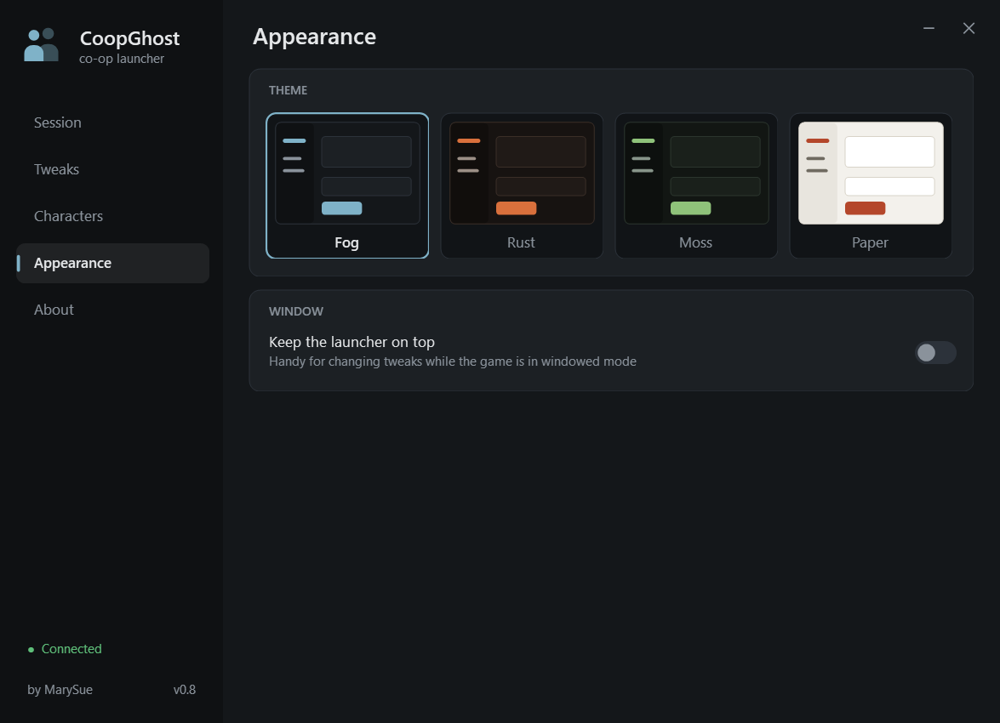
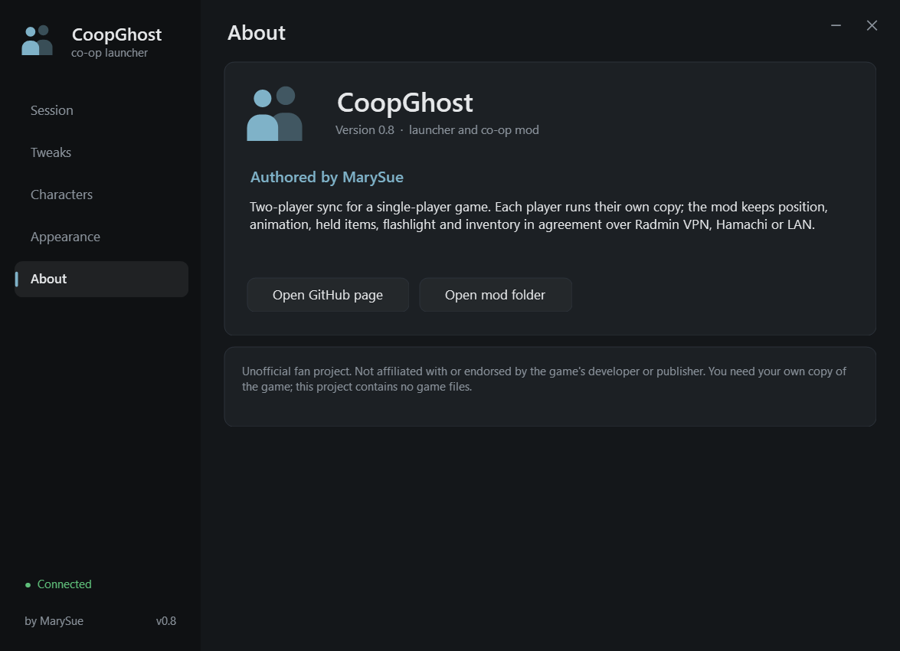
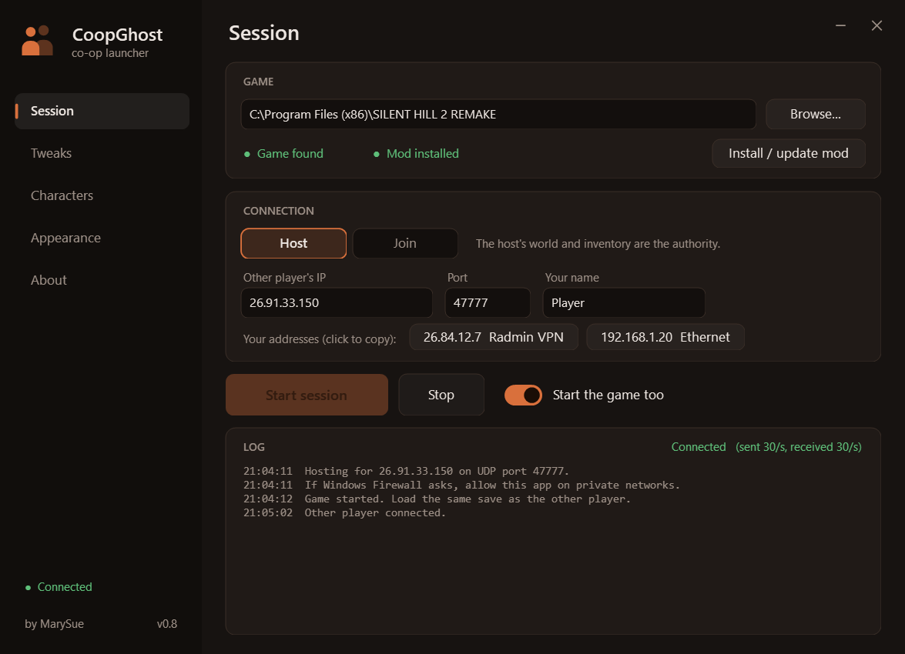
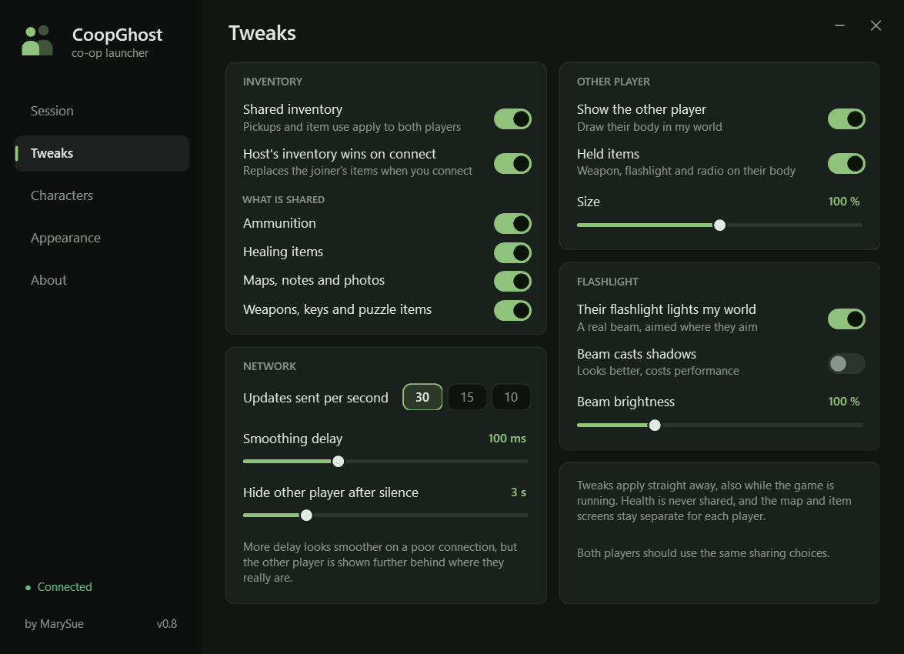
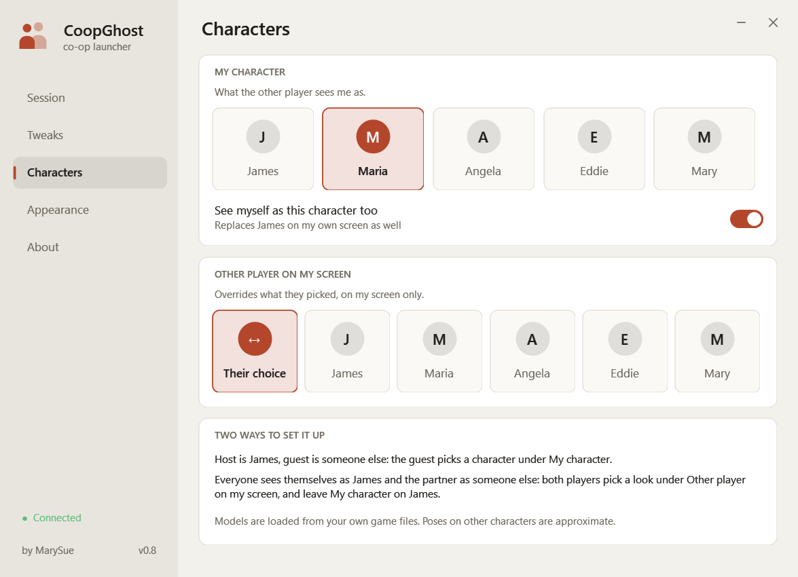

# CoopGhost

**Experimental two-player co-op for Silent Hill 2 (2024), with a launcher.** Authored by MarySue.

The game has no multiplayer. CoopGhost lets two people play side by side anyway: each runs their
own copy of the game, and the mod keeps the two copies in agreement over Radmin VPN, Hamachi or
a LAN. You see the other player in your world, fully animated, holding what they hold, with their
flashlight lighting your surroundings, and you share one inventory.

> Unofficial fan project. Not affiliated with or endorsed by the game's developer or publisher.
> You need your own copy of the game. This repository contains no game files.



## Status

This is a work in progress. Everything marked working has been tested by one player against a
simulated second player; a full session between two real PCs still needs testing.

| Feature | Status |
|---|---|
| Other player visible, full-body animation mirrored every frame | Working |
| Equipped weapon, flashlight and radio shown on the other player | Working |
| Other player's flashlight beam lights your world | Working |
| Shared inventory (ammo, healing, documents, key items), each kind switchable | Working |
| Play as James, Maria, Angela, Eddie or Mary, for the other player and on your own screen | Working, poses on non-James bodies are approximate |
| Launcher: host / join, install, live tweaks, themes | Working, network path needs a two-PC test |
| Health | Separate on purpose |
| Map and item-inspection screens | Separate (they are local menus) |
| Shared enemies and combat | Not started |
| Shared puzzles, doors, cutscenes and progress | Not started |

Until the last two rows exist, each player still fights their own enemies and solves their own
puzzles. Play through the same areas together and it holds up; drift apart and the worlds diverge.

## The launcher

| Tweaks | Characters |
|---|---|
|  |  |

| Appearance | About |
|---|---|
|  |  |

Four themes are built in:

| Rust | Moss | Paper |
|---|---|---|
|  |  |  |

### Tweaks

All tweaks apply immediately, also while the game is running.

| Group | Tweak | Default |
|---|---|---|
| Inventory | Shared inventory | on |
| | Host's inventory replaces the joiner's on connect | on |
| | Share ammunition / healing items / maps, notes and photos / weapons, keys and puzzle items | all on |
| Other player | Show the other player | on |
| | Show held items (weapon, flashlight, radio) | on |
| | Size | 100 % |
| Flashlight | Their flashlight lights my world | on |
| | Beam casts shadows | off |
| | Beam brightness | 100 % |
| Network | Updates sent per second (30 / 15 / 10) | 30 |
| | Smoothing delay | 100 ms |
| | Hide the other player after silence | 3 s |
| Characters | My character (what the other player sees) | James |
| | See myself as that character too | on |
| | Other player on my screen (overrides their choice) | their choice |
| Launcher | Theme, keep on top, start the game with the session | |

## Requirements

- Windows, and the PC version of the game. Built and tested on game build 1.0.0.5.
- Both players on the same game build, starting from the same save in the same area.
- A network where the two PCs can reach each other by IP: Radmin VPN, Hamachi or LAN.
- [UE4SS](https://github.com/UE4SS-RE/RE-UE4SS) (experimental build), which loads the mod.
  The packaged release bundles it; from source you install it yourself.

## Play

1. Get `CoopGhost.zip` (build it with `tools\build_dist.ps1`, see below), unzip it anywhere and
   run `CoopLauncher.exe`.
2. Set the game folder (the one containing `SHProto.exe`) and press **Install / update mod** if
   the launcher says the mod is not installed. If the game is under Program Files the launcher
   offers to restart itself as administrator.
3. One player picks **Host**, the other **Join**. Each enters the *other* player's address. The
   launcher lists your own addresses; click one to copy it.
4. Press **Start session**. Allow the launcher through Windows Firewall if asked (UDP 47777).
5. Both load the same save. The status turns green when packets arrive from the other player.

In game, **F9** toggles a solo test: the other player's body appears beside you and copies you.

To uninstall, delete `dwmapi.dll` and the `ue4ss` folder from `<game>\SHProto\Binaries\Win64`.

## How it works

The game ships without any networking, and Lua inside UE4SS has no sockets, so the design is:

```
 game A  <-- files -->  launcher A  <== UDP over VPN ==>  launcher B  <-- files -->  game B
 (mod)       ipc\                                                          ipc\       (mod)
```

- **The mod** (`CoopGhost\Scripts\core.lua`) runs inside each game. About 30 times a second it
  measures the local player (position, 27 bone rotations, held items, flashlight) and writes
  that to `ipc\out.txt`. It reads the other player's state from `ipc\in.txt`.
- **The launcher** carries those small text packets between the PCs over UDP.
- **The other player's body** is a poseable copy of a character mesh already in your game. No
  animation blueprint runs on it; every rendered frame its bones are set to a blend of the two
  most recent snapshots, drawn slightly in the past so network jitter does not show.
- **Inventory** is synced as reliable events: each gain or loss is resent until the other side
  acknowledges it. On connect the host's inventory is the starting point.
- **Seeing yourself as another character** keeps the real James animating but invisible, and
  poses a second body from him every frame, fingers included.

`core.lua` is hot-reloaded when it changes, so the mod can be developed with the game running.

## Building from source

Requirements: Windows with .NET Framework 4 (for the bundled C# compiler) and PowerShell.

```powershell
powershell -ExecutionPolicy Bypass -File tools\build_dist.ps1
```

This compiles the launcher and assembles `dist\CoopGhost\` and `dist\CoopGhost.zip`. It copies
UE4SS from your own game folder, so install UE4SS into the game first.

Regenerate the README screenshots (demo data, no personal settings) with:

```powershell
dist\CoopGhost\CoopLauncher.exe --screenshots docs\screenshots --scale 1.25
```

## Project layout

| Path | What |
|---|---|
| `CoopGhost\Scripts\main.lua` | Tiny bootstrap; reloads `core.lua` whenever it changes |
| `CoopGhost\Scripts\core.lua` | The mod |
| `CoopGhost\relay.ps1` | Script version of the launcher's network relay, kept as a fallback |
| `launcher\CoopLauncher.cs` | The launcher (WinForms, custom-drawn, single file) |
| `tools\build_dist.ps1` | Builds the launcher and the distributable zip |
| `tools\run.ps1`, `tools\cmd\` | Run Lua snippets inside the live game; the probes used to map it |
| `tools\list_pak_paths.ps1` | Lists asset paths from the game's container index |

## Credits

- [UE4SS](https://github.com/UE4SS-RE/RE-UE4SS) by the UE4SS-RE team, which makes scripting the
  game possible.
- Mod and launcher by MarySue.

## License

[MIT](LICENSE) for the code in this repository. The game, its characters and its assets belong
to their respective owners and are not included here.
